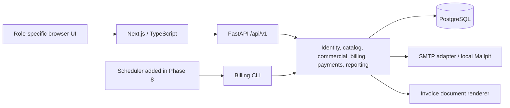

# Brightloop - Phase 0 architecture and handoff

Status: PHASE 0 ACCEPTED BY TEAM on 31 October 2026. Implementation proceeds with Phase 1.

## Repository assessment and boundaries

Inspected branch: `v2-DEN` (commit `c5e29fd`). Existing planning, environment helpers and Compose files are preserved. PostgreSQL 18 is local on Windows with separate development/test database owners. Docker runs the local Mailpit inbox; it does not duplicate PostgreSQL. Existing private environment files are ignored. Connectivity and email checks were run during environment setup; Phase 0 does not rerun them or change database records.

There are no application source modules, dependency manifests, ORM models, migrations or application tests yet. No Phase 1 code is introduced here. Existing working-tree changes remain uncommitted; no commit, push or ownership assignment to real teammates is invented.

Read [business-rules.md](business-rules.md) for decisions/examples; [database-design.md](database-design.md) for entities/constraints; [api-design.md](api-design.md) for routes/permissions; [USER_FLOWS.md](USER_FLOWS.md) for the unchanged 32-template interface; [PLANNING_VERIFICATION.md](PLANNING_VERIFICATION.md) for source traceability.

## Architecture



One modular backend with direct SQLAlchemy sessions; no queue/worker/cache platform. Backend routes validate Pydantic schemas, enforce dependencies and call services. Services define transactions. Repository/query helpers are added only for recurring nontrivial queries. One Decimal calculator serves previews, agreements and invoices. Documents render persisted snapshots only. Browser API client handles structured errors and auth; React Hook Form/Zod handles local feedback and TanStack Query refreshes appropriate query keys after writes.

Proposed layout, adapted in Phase 1 rather than created blindly:

```text
backend/
  app/core/                 configuration, security, errors
  app/db/                   engine, metadata, sessions
  app/api/v1/               routers and auth/ownership dependencies
  app/schemas/              explicit request/response DTOs
  app/models/               relational entities
  app/services/             domain rules, transactions, pricing, billing
  app/queries/              scoped lists/aggregates where useful
  app/adapters/             SMTP and PDF
  app/cli/                  admin bootstrap and same-service billing
  alembic/                  reviewed migrations
  tests/                    unit and PostgreSQL integration
frontend/
  src/app/                  public, operational and portal routes
  src/components/           shared accessible UI/forms
  src/lib/                  API, validation, formatting
  tests/e2e/                critical role journeys
docs/                       accepted design, decisions and evidence
scripts/                    local environment helpers
compose.yaml                local Mailpit
```

## Transaction and recovery contracts

**Signup/reset/link:** normalize input; hash passwords outside long locks; inside one transaction lock customer/challenge, recheck unused/unexpired token and email uniqueness, write user/link or password/session revocations, audit and consume token. Email after commit; failed send does not create an accessible unverified customer link. Persist a delivery attempt, retain hashed challenge only; a retry regenerates a fresh token rather than recovering a raw secret from storage.

**Commercial commands:** lock subscription first; check actor, expected_version, state and plan snapshot; load pinned commercial lines; validate dates/overlap; insert immutable version/event and update root cache/version in the same transaction. A command receipt unique on actor/operation/key holds request hash and result identity. An approved customer request gets a unique event link; direct staff commands use the same service and idempotency receipt.

**Billing:** create run; enumerate due subscriptions in stable order and bounded batches (proposed 100 subscriptions per batch). For each chronological period, use one independent transaction: lock subscription; derive historical eligibility/version/anchor; apply due event once; check existing period invoice; lock applicable discount rules in sorted UUID order; recompute cap/eligibility; calculate; insert invoice/lines/taxes/allocations/redemptions; advance cursor; record successful outcome; commit. If period already exists, reconcile cursor with its persisted boundary and return existing identity; never calculate an alternate invoice.

On exception roll back the period, then persist a safe FAILED outcome in a fresh transaction. Do not continue later periods on the failing subscription. Continue other subscriptions. Distinguish CREATED/EXISTING/FAILED and remaining backlog; interrupted RUNNING runs can be labeled interrupted/retried from actual financial state. Bound synchronous admin work (proposed max 100 periods per request); report remaining work instead of false complete success. CLI/scheduler can repeat batches. Uniqueness is a final race guard, not a substitute for locks. If outcome logging fails after commit, retry reconstructs success from the invoice; financial commit remains authoritative.

**Payment:** lock invoice before changing its status or adding payment. Check globally unique request key/hash, issued state, current persisted sum and amount. Insert payment and audit; update any paid/balance/status cache atomically. Another request waits then recomputes. Cancellation takes the same invoice lock and rechecks zero payments. Concurrent key collisions roll back then return the matching original or 409; do not leave the transaction in a failed state.

**Discount:** all cap changes and redemptions lock the same rule row. Used count derives from committed rows; no independent mutable counter required initially. No SMTP/PDF generation inside a financial transaction. Preserve the accepted pinned tax/rule revision used for period replay.

**Delivery:** record pending attempt, commit, then call SMTP; mark SENT/FAILED/UNKNOWN independently. SMTP acceptance does not guarantee remote receipt; ambiguous retries can duplicate mail, never invoices. Initial system has explicit retry, not an invented reliable distributed outbox. Local Mailpit is adequate for delivery testing. Invoice PDFs and audits never contain reset/session tokens or unnecessary personal data.

## Sessions and browser security

Recommend opaque random server sessions stored hashed; HttpOnly session cookie, SameSite=Lax, Secure in HTTPS deployment. Local HTTP explicitly disables Secure only in development. Exact frontend origins allowlisted; credentialed CORS has no wildcard. Browser uses credentials on API calls.

State-changing cookie-authenticated calls require a server-bound CSRF token header and exact Origin checks, including login/logout/reset flows using pre-auth CSRF context. CSRF tokens have random entropy, are bound to a session/pre-auth challenge and are rotated on login. No authentication tokens in localStorage. Production must use HTTPS; no deployment configuration is claimed here. Errors/rate-limit responses are safe and consistent; an initial single-process local auth limiter is documented as such, not falsely multi-worker distributed protection.

## Performance and testing design

Page/render lists are bounded, filters/sorts allowlisted, detail relations explicitly loaded to prevent N+1 queries. Customer scope applies before aggregation. Reports use SQL sums/counts and indexed filters. Review query plans with seeded data before adding indexes. Pool sizing/timeouts follow actual concurrency/environment in Phase 1; exact dependency versions are checked and pinned then.

Unit expectations are the business-rule examples. PostgreSQL gates exercise composite FKs, email/period/key uniqueness, deletion protection, concurrent discount caps/payments, rollback and historical replay. Billing batch fixture: 300 subscriptions due together, mixed states and injected failure. Browser tests cover auth, catalog, quote-to-subscription, invoice/payment, ownership and request approval in the phases introducing them.

Phase 9 baseline proposal: Windows development host, same local PostgreSQL and Docker Mailpit, 5,000 subscriptions/50,000 invoices/100,000 payments; browser navigation until primary content is usable, cold/warm runs for all 32 templates using valid record/token fixtures, proposed 20 samples per template at 1 and 5 concurrent sessions. Record exact CPU/RAM/runtime versions at execution, p50/p95/max and failures. Every sampled designated page must be under two seconds. No measurement or performance guarantee is claimed now; approve environment/concurrency before using this as acceptance evidence.

## Team work and acceptance

| Responsibility | Deliverable / teammate assignment |
|---|---|
| Database lead + reviewer | ERD, constraints, migrations, lock/recovery explanations; names pending team assignment |
| Backend lead + reviewer | API/domain implementation, validation/authorization; names pending |
| Frontend lead + reviewer | Delivered page workflows, accessibility/navigation; names pending |
| Integration lead + reviewer | Fixtures, role/browser checks, reproducibility/performance; names pending |
| Everyone | Meaningful Git contributions, review another member, explain own code and shared flow |

Responsibilities may be combined in a smaller team; no contributor names/capacity or completion deadline were supplied. Work within the current accepted phase; review small branches/PRs and do not force-push shared work. Preserve current uncommitted files until the team chooses a commit/review boundary.

Phase 0 checklist:

- [x] Repository and environment state assessed without exposing secrets.
- [x] Source coverage and existing 32 pages/15 journeys linked to design responsibilities.
- [x] Concrete D01-D10 recommendations, state tables and worked expected values prepared.
- [x] Relational schema, cardinalities, constraints, snapshots and transactions specified.
- [x] API outline, permissions, errors and retry contracts prepared.
- [x] Team accepts D01-D10 or requests changes; schema/API/page updates follow any changed decision.
- [x] Team reviews ERD and accepts the interface/lifecycle/financial correction limitations.
- [x] Assign actual owners/reviewers and accept performance test conditions.

**Gate: PASS.** Phase 0 design and decisions D01–D10 accepted by the team on 31 October 2026. Phase 1 implementation authorized.

## Phase 0 verification evidence

Performed 31 October 2026: `git status --short --branch`, `rg --files docs scripts`, document reads, `git diff --check`, `git diff --stat`, and `python -` with read-only inline assertions. The Python assertions checked all 9 Markdown files for local links/balanced fences/trailing whitespace; 32 unique page IDs/routes and phase counts; 15 journeys; 10 ordered phases; 10 decision rows; 36 defined schema entities and all ER diagram entity references. Decimal calculations independently reconciled the 2,888.64 worked invoice and 500.00 final-period example. All those checks passed. The ER syntax was inspected as text; no rendered-diagram visual check or database constraint execution is claimed.

Created business-rules.md, database-design.md, api-design.md and this file; updated BUILD_GUIDE.md, USER_FLOWS.md and README.md to reference one proposed rule source and expose seat/excess pricing fields. Existing AGENTS.md and environment work were preserved. No application models, migrations, runtime tests or database modifications were performed in this phase. Working-tree changes are not committed/pushed.
