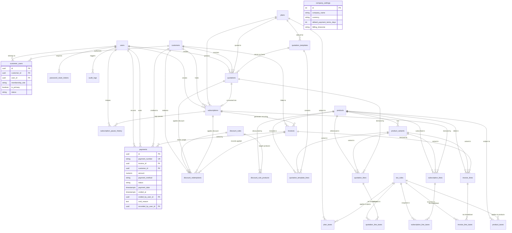
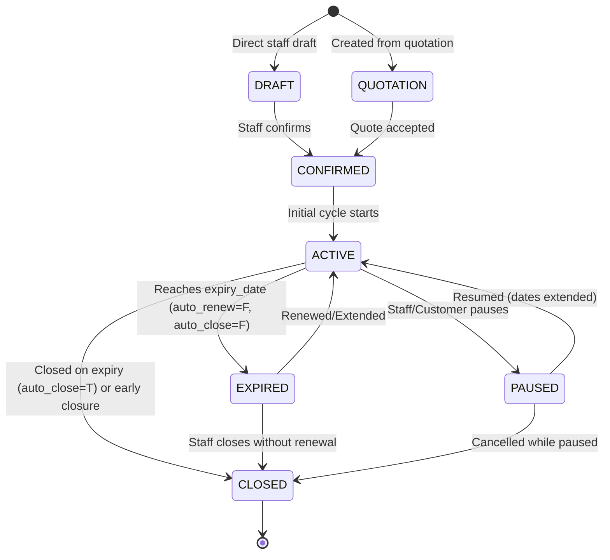

# Brightloop Subscription Management System — Database Architecture & ER Design

**Document Version:** 4.1.0 (Stage 2 Final Verified Architecture Specification)
**Status:** Approved Architectural Specification
**Database Engine:** PostgreSQL 16 (with `btree_gist` extension for range exclusion)
**Architectural Discipline:** Strict Normalization, Composite Foreign Key Consistency, Half-Open Date Ranges, Statutory Tax Versioning, Polymorphic Generalized Line Model, Explicit Rounding Reconciliation, Decimal Precision, Transactional Row Locking

---

## 1. Executive Summary & Architectural Pillars

The Brightloop database architecture establishes an enterprise-grade relational foundation for recurring subscriptions, dynamic product catalogs, quotation workflows, itemized tax versioning, promotional discount rules, idempotent automated billing, and multi-payment settlement.

### Core Architectural Pillars
1. **Financial Immutability & Snapshot Integrity:**
   Catalog edits (base prices, variant adjustments, or promotional rules) never rewrite historical financial documents. All quoted and invoiced line items preserve frozen commercial snapshots.
2. **Statutory Tax Versioning with Effective Date Windows & Non-Overlapping Key:**
   Tax rules carry jurisdiction (`country`, `state`, `scope`) and effective date boundaries (`valid_from`, `valid_until`). PostgreSQL exclusion constraints prevent overlapping versions for the same jurisdiction scope while allowing concurrent coexisting tax components (e.g. CGST and SGST).
3. **Cross-Table Referential Consistency via Composite Keys:**
   Composite foreign keys guarantee that child entities (invoices, payments, redemptions, subscriptions) can never disagree with their parent's customer identity, and variant references are strictly verified to belong to the parent product.
4. **Billing Idempotency & Replacement-Safe Overlap Prevention:**
   Billing periods use half-open intervals `[start, end)` on calendar dates. Overlapping billing cycles for the same subscription are strictly prevented using a filtered PostgreSQL range exclusion constraint (`EXCLUDE USING gist ... WHERE (status != 'CANCELLED')`), allowing authorized replacement invoices while blocking duplicate active billing.
5. **Multi-User Organization Security & Primary Membership Integrity:**
   Customer organizations support multiple user accounts with distinct roles (`OWNER`, `BILLING_ADMIN`, etc.). A partial unique index guarantees at most one active primary contact, and check constraints enforce that primary contacts must hold the `OWNER` role.
6. **Polymorphic Generalized Line Model:**
   Plan base platform fees and product lines share a unified line architecture (`line_type IN ('PLAN_FEE', 'PRODUCT')`), providing universal itemized tax snapshots and eliminating redundant snapshot tables.
7. **Strict Monetary Precision & Explicit Rounding Reconciliation:**
   All line items and intermediate taxes calculate at 4 decimal places (`NUMERIC(12, 4)`). Document totals reconcile 4-decimal sums into 2 decimal places (`NUMERIC(12, 2)`). Four separate rounding operations (subtotal, discount, tax, and final payable total), each with an individual error bound of $\pm 0.005$, yield a mathematically provable maximum compounding variance of $\pm 0.02$. Ordinary currency rounding of the exact statutory tax sum to two decimal places is permitted for accounting display (`tax_amount = ROUND(exact_tax, 2)`), but altering the rounded statutory tax amount to absorb other document rounding discrepancies is strictly prohibited; all rounding deltas are isolated in `rounding_adjustment` on document headers and rendered as presentation-only summary rows.
8. **Transactional Payment Synchronization & Concurrency Control:**
   Invoice payment status and balance tracking maintain the aggregate invariant (`invoices.amount_paid = COALESCE(SUM(payments.amount) FILTER (WHERE payments.status = 'SUCCESS'), 0.00)`) executed inside row-locked backend transactions (`SELECT ... FOR UPDATE`), which verify available balance and prevent payment records from exceeding the invoice balance. Stored invoice arithmetic and non-negative balance boundaries are enforced by database check constraints. Commercial payment attributes are immutable, with a one-way administrative void protocol that atomically restores invoice balances.

---

## 2. Stage 2 — Engineering Review & Architectural Enforcement

This section details each refined architectural component, comparing earlier designs with the final specification and defining the exact division of enforcement between PostgreSQL and the FastAPI backend service layer.

| # | Domain / Component | Previous Design | Revised Final Design | Reason | Database-Level Enforcement | Backend-Level Enforcement |
|---|---|---|---|---|---|---|
| **1** | **Subscription Lifecycle & Permitted States** | `EXPIRED` status was omitted from `subscriptions.status` CHECK constraint; transitions were ambiguous. | Added `EXPIRED` to permitted status set: `CHECK (status IN ('DRAFT', 'QUOTATION', 'CONFIRMED', 'ACTIVE', 'PAUSED', 'EXPIRED', 'CLOSED'))`. Defined complete state machine. | When a term contract with `auto_renew = FALSE` and `auto_close_on_expiry = FALSE` reaches `expiry_date`, it transitions to `EXPIRED` (administrative grace period). | Check constraint on `subscriptions.status`. | Orchestrates state transitions; halts automated recurring billing upon reaching `EXPIRED`; triggers renewal alerts. |
| **2** | **Financial Rounding Calculation Sequence** | Subtotal, discount, and tax were rounded to 2 decimals before calculating `unrounded_total`, making rounding adjustment zero. | Calculations accumulate at full 4-decimal line precision. `exact_unrounded_total = exact_subtotal - exact_discount + exact_tax`. Four rounding operations (subtotal, discount, tax, payable total) each introduce at most $\pm 0.005$ error, proving a maximum compound adjustment of $\pm 0.02$. Ordinary currency rounding of the exact statutory tax sum to 2 decimal places is permitted (`tax_amount = ROUND(exact_tax, 2)`). Altering the rounded statutory tax amount to absorb other document rounding discrepancies is prohibited. | Column `rounding_adjustment NUMERIC(12, 2)`; `CHECK (rounding_adjustment BETWEEN -0.02 AND 0.02)`; `CHECK (total_amount = subtotal_amount - discount_amount + tax_amount + rounding_adjustment)`. | Computes 4-decimal line math; rounds document components; calculates balancing adjustment; validates document balance. |
| **3** | **Rounding Adjustment Presentation** | Ambiguity over whether rounding adjustment was a database line item or header component. | Clarified that rounding adjustment is stored strictly on document headers (`invoices`, `quotations`) and rendered as a presentation-only summary row in UI/PDFs, not a row in `invoice_lines`. | `invoice_lines` strictly represents goods and services (`PLAN_FEE`, `PRODUCT`). Injecting rounding rows into line tables pollutes financial itemization and tax mapping. | `line_type IN ('PLAN_FEE', 'PRODUCT')` check constraint on line tables. | Injects presentation row into invoice/quotation view models immediately preceding total payable. |
| **4** | **Quotation-to-Subscription Customer Integrity** | `subscriptions.quotation_id` referenced `quotations(id)` with a simple foreign key, allowing customer mismatch. | Added composite foreign key `FOREIGN KEY (quotation_id, customer_id) REFERENCES quotations(id, customer_id) ON DELETE RESTRICT`. Nullable `quotation_id` allows direct subscriptions. | Eliminates cross-tenant reference errors. Guarantees that a subscription for Customer A cannot reference a quotation belonging to Customer B. | Composite FK on `(quotation_id, customer_id)` with `MATCH SIMPLE`; partial unique index `uq_subscription_quotation ON subscriptions (quotation_id) WHERE (quotation_id IS NOT NULL)`. | Verifies customer tenancy before linking quotation to subscription. |
| **5** | **Discount Redemption Customer Integrity** | Redemptions lacked a composite check against subscription customer ownership. | Added composite foreign key `FOREIGN KEY (subscription_id, customer_id) REFERENCES subscriptions(id, customer_id) ON DELETE RESTRICT`. Compatible with `invoice_id XOR quotation_id`. | Guarantees that multi-cycle recurring subscription discounts belong to the exact same customer organization. | Composite FK `(subscription_id, customer_id)` on `discount_redemptions`; strict XOR check constraint on document links. | Validates redemption eligibility, cycle limits, and customer matching. |
| **6** | **Invoice Product Deletion Protection** | `invoice_lines.product_id` used `ON DELETE SET NULL`, which violated `line_type = 'PRODUCT'` check constraint requiring non-null `product_id`. | Changed `invoice_lines.product_id` deletion policy to `ON DELETE RESTRICT`. Retained exactly one product FK relationship while preserving composite variant/product FK. | Historical invoices are legally immutable accounting records; referenced catalog products must never be cascaded or nulled out. | `FOREIGN KEY (product_id) REFERENCES products(id) ON DELETE RESTRICT` (on column definition). | Blocks hard deletion of billed products; enforces soft deactivation via `is_active = FALSE`. |
| **7** | **Payment Synchronization & Concurrency Invariant** | Ambiguous boundary between row check constraints and cross-table payment sums. | Explicitly established that `invoices.amount_paid = COALESCE(SUM(payments.amount) FILTER (WHERE status = 'SUCCESS'), 0.00)` is enforced via row-locking backend transactions (`SELECT ... FOR UPDATE`). Commercial attributes are immutable; one-way void operations atomically restore balances. | Single-row check constraints enforce stored invoice arithmetic (`amount_paid <= total_amount`, `balance_due = total_amount - amount_paid`). Composite FK `(invoice_id, customer_id)`. Payment void state check constraint. | Executes atomic `SELECT FOR UPDATE -> INSERT payment -> UPDATE invoice` and void transactions; checks available balance; excludes voided payments from aggregate. |
| **8** | **Plan Fee Tax Snapshots** | Plan fees had no explicit tax snapshot table on quotations and subscriptions. | Adopted Generalized Line Model (`line_type IN ('PLAN_FEE', 'PRODUCT')`) on line tables. Plan fee taxes captured in line tax tables. | Unifies pricing, discounts, and itemized multi-tax calculations across all billing items. Guarantees 100% historical tax reproducibility. | `line_type` column with check constraint; partial unique index ensuring at most one `PLAN_FEE` line per document; `NOT NULL` snapshot columns. | Pre-populates plan fee line and taxes from `plans` and `plan_taxes`; validates line totals and tax breakdowns. |
| **9** | **Tax Rule Effective Periods & Overlap Prevention** | Tax rules had static rates without validity dates or regional jurisdictions. | Added `valid_from`, `valid_until`, `jurisdiction_country`, `jurisdiction_state`, and `tax_scope`. Enforced non-overlapping versions via GiST range exclusion. | Prevents conflicting statutory tax rates active in the same jurisdiction while allowing distinct tax components (CGST + SGST) to coexist. | PostgreSQL exclusion constraint: `EXCLUDE USING gist (jurisdiction_country WITH =, jurisdiction_state WITH =, tax_scope WITH =, tstzrange(valid_from, valid_until, '[)') WITH &&) WHERE (is_active = TRUE)`. | Matches customer location and invoice date against effective tax rules; resolves CGST+SGST vs IGST applicability. |
| **10**| **Cancelled Invoices & Replacement-Safe GiST** | Unconditional GiST exclusion constraint blocked generating an authorized replacement invoice if an errant invoice was cancelled. | Filtered GiST exclusion constraint: `EXCLUDE USING gist (...) WHERE (status != 'CANCELLED')`. | Allows staff to cancel an incorrect invoice and re-issue a corrected replacement invoice for the same billing period while blocking duplicate active invoices. | PostgreSQL exclusion constraint with `WHERE (status != 'CANCELLED')` predicate. | Validates cancellation workflow and requires operational memo in `notes` before cancelling an invoice. |
| **11**| **`btree_gist` Migration Requirement** | GiST exclusion on `UUID` and `daterange` was specified without explicitly noting the prerequisite extension. | Documented that `CREATE EXTENSION IF NOT EXISTS btree_gist;` must be executed in the initial migration before applying the exclusion constraint. | PostgreSQL GiST indexing on scalar types like `UUID` requires the `btree_gist` module. | `CREATE EXTENSION IF NOT EXISTS btree_gist;` in Alembic migration revision. | Verifies extension presence during database connectivity and readiness health check. |
| **12**| **Subscription Pause Concurrency & Day Math** | Multiple open pauses were possible; same-day pause behavior was ambiguous. | Added partial unique index `idx_sub_pause_single_open` on `(subscription_id) WHERE (resumed_at IS NULL)`. Defined same-calendar-day pause as `days_extended = 0`. | Prevents concurrent duplicate pause records. Guarantees deterministic calendar day arithmetic without billing penalties. | `CREATE UNIQUE INDEX idx_sub_pause_single_open ON subscription_pause_history (subscription_id) WHERE (resumed_at IS NULL);`, `CHECK (days_extended >= 0)`. | Calculates `days_extended = (DATE(resumed_at AT TIME ZONE 'Asia/Kolkata') - DATE(paused_at AT TIME ZONE 'Asia/Kolkata'))`. |
| **13**| **Primary Customer Membership & Owner Role** | `is_primary` was not explicitly restricted to the `OWNER` membership role. | Added `CHECK (is_primary = FALSE OR membership_role = 'OWNER')`. Partial unique index enforces at-most-one active primary contact. | Guarantees that only an account with full administrative ownership can be designated as the primary contact. | Check constraint `CHECK (is_primary = FALSE OR membership_role = 'OWNER')` and partial unique index on `(customer_id) WHERE (is_primary = TRUE AND status = 'ACTIVE')`. | Enforces exactly-one primary active owner during registration and ownership transfer workflows. |
| **14**| **Product-Variant Consistency** | Line items referenced `product_id` and `variant_id` independently. | Added `UNIQUE (id, product_id)` on `product_variants`. Added composite foreign key `FOREIGN KEY (variant_id, product_id) REFERENCES product_variants(id, product_id)` on all line tables. | Prevents corrupted records where a variant belongs to Product B but line item references Product A. | Composite foreign key on `(variant_id, product_id)` with `MATCH SIMPLE` (allows NULL `variant_id`). | Validates variant belonging to product prior to constructing DTOs. |

---

## 3. Complete Entity-Relationship (ER) Diagram



---

## 4. Comprehensive Data Dictionary (28 Entities)

### 4.1 Identity & Access Domain

#### `users`
System user accounts for authentication and tier authorization.
- `id`: UUID PRIMARY KEY (`gen_random_uuid()`)
- `email`: VARCHAR(255) NOT NULL UNIQUE, `CHECK (email = lower(email))`
- `hashed_password`: VARCHAR(255) NOT NULL (Argon2id)
- `full_name`: VARCHAR(150) NOT NULL
- `role`: VARCHAR(20) NOT NULL `CHECK (role IN ('ADMIN', 'STAFF', 'CUSTOMER'))`
- `is_active`: BOOLEAN NOT NULL DEFAULT TRUE
- `created_at`: TIMESTAMPTZ NOT NULL DEFAULT CURRENT_TIMESTAMP
- `updated_at`: TIMESTAMPTZ NOT NULL DEFAULT CURRENT_TIMESTAMP
- **Indexes:** `idx_users_email` (UNIQUE), `idx_users_role`

#### `password_reset_tokens`
Cryptographically hashed, single-use reset secrets.
- `id`: UUID PRIMARY KEY (`gen_random_uuid()`)
- `user_id`: UUID NOT NULL FK -> `users(id)` ON DELETE CASCADE
- `token_hash`: VARCHAR(255) NOT NULL UNIQUE (SHA-256)
- `expires_at`: TIMESTAMPTZ NOT NULL
- `is_used`: BOOLEAN NOT NULL DEFAULT FALSE
- `created_at`: TIMESTAMPTZ NOT NULL DEFAULT CURRENT_TIMESTAMP
- **Indexes:** `idx_pwd_reset_token_hash` (UNIQUE), `idx_pwd_reset_user_id`

---

### 4.2 Customer Organization Domain

#### `customers`
Legal business entity holding commercial contracts and billing profiles.
- `id`: UUID PRIMARY KEY (`gen_random_uuid()`)
- `company_name`: VARCHAR(200) NOT NULL
- `contact_email`: VARCHAR(255) NOT NULL `CHECK (contact_email = lower(contact_email))`
- `contact_phone`: VARCHAR(50) NULLABLE
- `tax_number`: VARCHAR(50) NULLABLE (GSTIN / VAT ID)
- `billing_address_line1`: VARCHAR(255) NOT NULL
- `billing_address_line2`: VARCHAR(255) NULLABLE
- `city`: VARCHAR(100) NOT NULL
- `state`: VARCHAR(100) NOT NULL
- `postal_code`: VARCHAR(20) NOT NULL
- `country`: VARCHAR(2) NOT NULL DEFAULT 'IN' `CHECK (length(country) = 2)`
- `currency`: VARCHAR(3) NOT NULL DEFAULT 'INR'
- `is_active`: BOOLEAN NOT NULL DEFAULT TRUE
- `created_at`: TIMESTAMPTZ NOT NULL DEFAULT CURRENT_TIMESTAMP
- `updated_at`: TIMESTAMPTZ NOT NULL DEFAULT CURRENT_TIMESTAMP
- **Indexes:** `idx_customers_company_name`, `idx_customers_contact_email`

#### `customer_users`
Authorized user memberships for customer organizations.
- `id`: UUID PRIMARY KEY (`gen_random_uuid()`)
- `customer_id`: UUID NOT NULL FK -> `customers(id)` ON DELETE CASCADE
- `user_id`: UUID NOT NULL FK -> `users(id)` ON DELETE CASCADE
- `membership_role`: VARCHAR(30) NOT NULL DEFAULT 'VIEWER' `CHECK (membership_role IN ('OWNER', 'BILLING_ADMIN', 'TECHNICAL_CONTACT', 'VIEWER'))`
- `is_primary`: BOOLEAN NOT NULL DEFAULT FALSE
- `status`: VARCHAR(20) NOT NULL DEFAULT 'ACTIVE' `CHECK (status IN ('ACTIVE', 'INVITED', 'SUSPENDED'))`
- `created_at`: TIMESTAMPTZ NOT NULL DEFAULT CURRENT_TIMESTAMP
- `updated_at`: TIMESTAMPTZ NOT NULL DEFAULT CURRENT_TIMESTAMP
- **Constraints & Indexes:**
  - `CONSTRAINT uq_customer_user UNIQUE (customer_id, user_id)`
  - `CHECK (is_primary = FALSE OR membership_role = 'OWNER')` (Primary contact must hold OWNER role).
  - `CREATE UNIQUE INDEX idx_customer_users_one_primary ON customer_users (customer_id) WHERE (is_primary = TRUE AND status = 'ACTIVE');` (Guarantees at-most-one active primary contact per customer).

---

### 4.3 Catalog, Plans & Statutory Taxes Domain

#### `products`
Catalog items available for purchase or recurring subscription lines.
- `id`: UUID PRIMARY KEY (`gen_random_uuid()`)
- `name`: VARCHAR(200) NOT NULL
- `product_type`: VARCHAR(50) NOT NULL DEFAULT 'SERVICE' `CHECK (product_type IN ('SERVICE', 'SOFTWARE', 'ADDON'))`
- `description`: TEXT NULLABLE
- `base_sales_price`: NUMERIC(12, 4) NOT NULL `CHECK (base_sales_price >= 0)`
- `cost_price`: NUMERIC(12, 4) NOT NULL DEFAULT 0 `CHECK (cost_price >= 0)`
- `is_active`: BOOLEAN NOT NULL DEFAULT TRUE
- `created_at`: TIMESTAMPTZ NOT NULL DEFAULT CURRENT_TIMESTAMP
- `updated_at`: TIMESTAMPTZ NOT NULL DEFAULT CURRENT_TIMESTAMP

#### `product_variants`
SKU-level price adjustments for products.
- `id`: UUID PRIMARY KEY (`gen_random_uuid()`)
- `product_id`: UUID NOT NULL FK -> `products(id)` ON DELETE RESTRICT
- `name`: VARCHAR(150) NOT NULL
- `price_adjustment`: NUMERIC(12, 4) NOT NULL DEFAULT 0
- `sku`: VARCHAR(100) NULLABLE UNIQUE
- `is_active`: BOOLEAN NOT NULL DEFAULT TRUE
- `created_at`: TIMESTAMPTZ NOT NULL DEFAULT CURRENT_TIMESTAMP
- `updated_at`: TIMESTAMPTZ NOT NULL DEFAULT CURRENT_TIMESTAMP
- **Constraints:** `CONSTRAINT uq_product_variant_pair UNIQUE (id, product_id)` (Enables composite foreign key integrity).

#### `plans`
Recurring contract templates establishing billing frequencies and base charges.
- `id`: UUID PRIMARY KEY (`gen_random_uuid()`)
- `name`: VARCHAR(150) NOT NULL UNIQUE
- `description`: TEXT NULLABLE
- `billing_interval`: VARCHAR(20) NOT NULL `CHECK (billing_interval IN ('DAILY', 'WEEKLY', 'MONTHLY', 'YEARLY'))`
- `interval_count`: INTEGER NOT NULL DEFAULT 1 `CHECK (interval_count > 0)`
- `base_price`: NUMERIC(12, 4) NOT NULL DEFAULT 0 `CHECK (base_price >= 0)`
- `minimum_quantity`: INTEGER NOT NULL DEFAULT 1 `CHECK (minimum_quantity >= 1)`
- `availability_start_date`: DATE NULLABLE
- `availability_end_date`: DATE NULLABLE
- `auto_renew`: BOOLEAN NOT NULL DEFAULT TRUE
- `auto_close_on_expiry`: BOOLEAN NOT NULL DEFAULT FALSE
- `allow_pause`: BOOLEAN NOT NULL DEFAULT TRUE
- `allow_early_closure`: BOOLEAN NOT NULL DEFAULT TRUE
- `is_active`: BOOLEAN NOT NULL DEFAULT TRUE
- `created_at`: TIMESTAMPTZ NOT NULL DEFAULT CURRENT_TIMESTAMP
- `updated_at`: TIMESTAMPTZ NOT NULL DEFAULT CURRENT_TIMESTAMP
- **Constraints:**
  - `CHECK (availability_end_date IS NULL OR availability_start_date IS NULL OR availability_end_date >= availability_start_date)`
  - `CHECK (auto_renew = FALSE OR auto_close_on_expiry = FALSE)` (Precedence & mutual exclusivity rule: plans that auto-renew cannot simultaneously auto-close).
  - *Lifecycle Rule for `auto_renew = FALSE` and `auto_close_on_expiry = FALSE`:* The subscription upon reaching `expiry_date` transitions to `status = 'EXPIRED'` (Administrative Grace / Awaiting Action). Automated recurring billing halts, and the subscription awaits manual renewal, contractual extension, or manual closure by staff.

#### `tax_rules`
Statutory tax rates, effective validity periods, and jurisdiction rules.
- `id`: UUID PRIMARY KEY (`gen_random_uuid()`)
- `name`: VARCHAR(100) NOT NULL (e.g., "CGST 9%", "SGST 9%", "IGST 18%")
- `rate`: NUMERIC(6, 4) NOT NULL `CHECK (rate >= 0 AND rate <= 100)`
- `tax_type`: VARCHAR(50) NOT NULL DEFAULT 'PERCENTAGE'
- `is_compound`: BOOLEAN NOT NULL DEFAULT FALSE
- `jurisdiction_country`: VARCHAR(2) NOT NULL DEFAULT 'IN'
- `jurisdiction_state`: VARCHAR(100) NOT NULL DEFAULT '' (Empty string for nationwide federal taxes)
- `tax_scope`: VARCHAR(50) NOT NULL DEFAULT 'STANDARD' `CHECK (tax_scope IN ('STANDARD', 'INTRASTATE_CGST', 'INTRASTATE_SGST', 'INTERSTATE_IGST', 'VAT', 'EXEMPT'))`
- `valid_from`: TIMESTAMPTZ NOT NULL DEFAULT CURRENT_TIMESTAMP
- `valid_until`: TIMESTAMPTZ NULLABLE
- `is_active`: BOOLEAN NOT NULL DEFAULT TRUE
- `created_at`: TIMESTAMPTZ NOT NULL DEFAULT CURRENT_TIMESTAMP
- `updated_at`: TIMESTAMPTZ NOT NULL DEFAULT CURRENT_TIMESTAMP
- **Constraints & Exclusion:**
  - `CHECK (valid_until IS NULL OR valid_until >= valid_from)`
  - **NON-OVERLAPPING TAX APPLICABILITY CONSTRAINT:**
    ```sql
    EXCLUDE USING gist (
        jurisdiction_country WITH =,
        jurisdiction_state WITH =,
        tax_scope WITH =,
        tstzrange(valid_from, valid_until, '[)') WITH &&
    ) WHERE (is_active = TRUE)
    ```

#### `product_taxes`
Many-to-many junction mapping tax rules to products.
- `product_id`: UUID NOT NULL FK -> `products(id)` ON DELETE CASCADE
- `tax_rule_id`: UUID NOT NULL FK -> `tax_rules(id)` ON DELETE RESTRICT
- **Constraints:** PRIMARY KEY `(product_id, tax_rule_id)`

#### `plan_taxes`
Many-to-many junction mapping tax rules to recurring plan base fees.
- `plan_id`: UUID NOT NULL FK -> `plans(id)` ON DELETE CASCADE
- `tax_rule_id`: UUID NOT NULL FK -> `tax_rules(id)` ON DELETE RESTRICT
- **Constraints:** PRIMARY KEY `(plan_id, tax_rule_id)`

---

### 4.4 Promotional Discounts Domain

#### `discount_rules`
Promotional rules, qualification thresholds, and usage caps.
- `id`: UUID PRIMARY KEY (`gen_random_uuid()`)
- `code`: VARCHAR(50) NOT NULL UNIQUE `CHECK (code = upper(code))`
- `name`: VARCHAR(150) NOT NULL
- `discount_type`: VARCHAR(20) NOT NULL `CHECK (discount_type IN ('PERCENTAGE', 'FIXED_AMOUNT'))`
- `discount_value`: NUMERIC(12, 4) NOT NULL `CHECK (discount_value > 0)`
- `scope`: VARCHAR(20) NOT NULL DEFAULT 'ORDER' `CHECK (scope IN ('ORDER', 'PRODUCT_SELECTION'))`
- `application_frequency`: VARCHAR(30) NOT NULL DEFAULT 'FIRST_INVOICE_ONLY' `CHECK (application_frequency IN ('FIRST_INVOICE_ONLY', 'RECURRING_ALL_CYCLES', 'FINITE_CYCLES'))`
- `max_cycles`: INTEGER NULLABLE `CHECK (max_cycles IS NULL OR max_cycles > 0)`
- `minimum_purchase_amount`: NUMERIC(12, 4) NOT NULL DEFAULT 0 `CHECK (minimum_purchase_amount >= 0)`
- `minimum_quantity`: INTEGER NOT NULL DEFAULT 1 `CHECK (minimum_quantity >= 1)`
- `valid_from`: TIMESTAMPTZ NULLABLE
- `valid_until`: TIMESTAMPTZ NULLABLE
- `max_uses`: INTEGER NULLABLE `CHECK (max_uses IS NULL OR max_uses > 0)`
- `current_uses`: INTEGER NOT NULL DEFAULT 0 `CHECK (current_uses >= 0)`
- `is_active`: BOOLEAN NOT NULL DEFAULT TRUE
- `created_at`: TIMESTAMPTZ NOT NULL DEFAULT CURRENT_TIMESTAMP
- `updated_at`: TIMESTAMPTZ NOT NULL DEFAULT CURRENT_TIMESTAMP
- **Constraints:** `CHECK (max_uses IS NULL OR current_uses <= max_uses)`

#### `discount_rule_products`
Maps promotional discount rules to one or more eligible products.
- `discount_rule_id`: UUID NOT NULL FK -> `discount_rules(id)` ON DELETE CASCADE
- `product_id`: UUID NOT NULL FK -> `products(id)` ON DELETE CASCADE
- **Constraints:** PRIMARY KEY `(discount_rule_id, product_id)`

#### `discount_redemptions`
Redemption ledger tracking promotional applications against financial documents.
- `id`: UUID PRIMARY KEY (`gen_random_uuid()`)
- `discount_rule_id`: UUID NOT NULL FK -> `discount_rules(id)` ON DELETE RESTRICT
- `customer_id`: UUID NOT NULL FK -> `customers(id)` ON DELETE RESTRICT
- `subscription_id`: UUID NULLABLE
- `invoice_id`: UUID NULLABLE
- `quotation_id`: UUID NULLABLE
- `amount_discounted`: NUMERIC(12, 4) NOT NULL `CHECK (amount_discounted > 0)`
- `cycle_number`: INTEGER NOT NULL DEFAULT 1 `CHECK (cycle_number > 0)`
- `redeemed_at`: TIMESTAMPTZ NOT NULL DEFAULT CURRENT_TIMESTAMP
- **Constraints & Foreign Keys:**
  - `CHECK ((invoice_id IS NOT NULL AND quotation_id IS NULL) OR (invoice_id IS NULL AND quotation_id IS NOT NULL))` (Strict XOR document link).
  - `FOREIGN KEY (invoice_id, customer_id) REFERENCES invoices(id, customer_id) ON DELETE RESTRICT` (Guarantees customer consistency and prevents cascading deletion of invoiced discounts).
  - `FOREIGN KEY (quotation_id, customer_id) REFERENCES quotations(id, customer_id) ON DELETE RESTRICT` (Guarantees customer consistency and prevents cascading deletion of quoted discounts).
  - `FOREIGN KEY (subscription_id, customer_id) REFERENCES subscriptions(id, customer_id) ON DELETE RESTRICT` (Guarantees customer consistency when discount redemption is tied to a recurring subscription; nullable for one-off documents).
  - `CREATE UNIQUE INDEX idx_discount_redemption_invoice ON discount_redemptions (discount_rule_id, invoice_id) WHERE (invoice_id IS NOT NULL);`
  - `CREATE UNIQUE INDEX idx_discount_redemption_quotation ON discount_redemptions (discount_rule_id, quotation_id) WHERE (quotation_id IS NOT NULL);`
  - `CREATE UNIQUE INDEX idx_discount_redemption_sub_cycle ON discount_redemptions (discount_rule_id, subscription_id, cycle_number) WHERE (subscription_id IS NOT NULL);`

---

### 4.5 Quotations & Templates Domain

#### `quotation_templates`
Reusable blueprints for staff quotation generation.
- `id`: UUID PRIMARY KEY (`gen_random_uuid()`)
- `name`: VARCHAR(150) NOT NULL UNIQUE
- `description`: TEXT NULLABLE
- `plan_id`: UUID NOT NULL FK -> `plans(id)` ON DELETE RESTRICT
- `validity_duration_days`: INTEGER NOT NULL DEFAULT 30 `CHECK (validity_duration_days > 0)`
- `is_active`: BOOLEAN NOT NULL DEFAULT TRUE
- `created_at`: TIMESTAMPTZ NOT NULL DEFAULT CURRENT_TIMESTAMP
- `updated_at`: TIMESTAMPTZ NOT NULL DEFAULT CURRENT_TIMESTAMP

#### `quotation_template_lines`
Itemized lines configured within a quotation template.
- `id`: UUID PRIMARY KEY (`gen_random_uuid()`)
- `template_id`: UUID NOT NULL FK -> `quotation_templates(id)` ON DELETE CASCADE
- `product_id`: UUID NOT NULL FK -> `products(id)` ON DELETE RESTRICT
- `variant_id`: UUID NULLABLE
- `quantity`: INTEGER NOT NULL DEFAULT 1 `CHECK (quantity > 0)`
- `unit_price_override`: NUMERIC(12, 4) NULLABLE `CHECK (unit_price_override IS NULL OR unit_price_override >= 0)`
- **Constraints:** `FOREIGN KEY (variant_id, product_id) REFERENCES product_variants(id, product_id) ON DELETE RESTRICT`

#### `quotations`
Commercial proposal prepared for a customer.
- `id`: UUID PRIMARY KEY (`gen_random_uuid()`)
- `quotation_number`: VARCHAR(50) NOT NULL UNIQUE
- `customer_id`: UUID NOT NULL FK -> `customers(id)` ON DELETE RESTRICT
- `template_id`: UUID NULLABLE FK -> `quotation_templates(id)` ON DELETE SET NULL
- `plan_id`: UUID NOT NULL FK -> `plans(id)` ON DELETE RESTRICT
- `status`: VARCHAR(20) NOT NULL DEFAULT 'DRAFT' `CHECK (status IN ('DRAFT', 'SENT', 'CONFIRMED', 'EXPIRED', 'REJECTED'))`
- `issue_date`: DATE NOT NULL DEFAULT CURRENT_DATE
- `expiry_date`: DATE NOT NULL
- `plan_price_snapshot`: NUMERIC(12, 4) NOT NULL `CHECK (plan_price_snapshot >= 0)`
- `subtotal_amount`: NUMERIC(12, 2) NOT NULL DEFAULT 0.00 `CHECK (subtotal_amount >= 0)`
- `discount_amount`: NUMERIC(12, 2) NOT NULL DEFAULT 0.00 `CHECK (discount_amount >= 0)`
- `tax_amount`: NUMERIC(12, 2) NOT NULL DEFAULT 0.00 `CHECK (tax_amount >= 0)`
- `rounding_adjustment`: NUMERIC(12, 2) NOT NULL DEFAULT 0.00 `CHECK (rounding_adjustment BETWEEN -0.02 AND 0.02)`
- `total_amount`: NUMERIC(12, 2) NOT NULL DEFAULT 0.00 `CHECK (total_amount >= 0)`
- `currency`: VARCHAR(3) NOT NULL DEFAULT 'INR'
- `notes`: TEXT NULLABLE
- `created_by_user_id`: UUID NOT NULL FK -> `users(id)` ON DELETE RESTRICT
- `created_at`: TIMESTAMPTZ NOT NULL DEFAULT CURRENT_TIMESTAMP
- `updated_at`: TIMESTAMPTZ NOT NULL DEFAULT CURRENT_TIMESTAMP
- **Constraints:**
  - `CONSTRAINT uq_quotation_customer UNIQUE (id, customer_id)`
  - `CHECK (expiry_date >= issue_date)`
  - `CHECK (total_amount = subtotal_amount - discount_amount + tax_amount + rounding_adjustment)`

#### `quotation_lines`
Frozen line items making up a quotation (both plan fee and product lines).
- `id`: UUID PRIMARY KEY (`gen_random_uuid()`)
- `quotation_id`: UUID NOT NULL FK -> `quotations(id)` ON DELETE CASCADE
- `line_type`: VARCHAR(20) NOT NULL DEFAULT 'PRODUCT' `CHECK (line_type IN ('PLAN_FEE', 'PRODUCT'))`
- `product_id`: UUID NULLABLE FK -> `products(id)` ON DELETE RESTRICT (NULL for `PLAN_FEE`)
- `variant_id`: UUID NULLABLE
- `description_snapshot`: VARCHAR(200) NOT NULL
- `unit_price`: NUMERIC(12, 4) NOT NULL `CHECK (unit_price >= 0)`
- `quantity`: INTEGER NOT NULL DEFAULT 1 `CHECK (quantity > 0)`
- `tax_rate_snapshot`: NUMERIC(6, 4) NOT NULL DEFAULT 0 `CHECK (tax_rate_snapshot >= 0)`
- `tax_amount`: NUMERIC(12, 4) NOT NULL DEFAULT 0 `CHECK (tax_amount >= 0)`
- `discount_amount`: NUMERIC(12, 4) NOT NULL DEFAULT 0 `CHECK (discount_amount >= 0)`
- `line_total`: NUMERIC(12, 4) NOT NULL `CHECK (line_total >= 0)`
- **Constraints & Indexes:**
  - `CHECK ((line_type = 'PLAN_FEE' AND product_id IS NULL AND variant_id IS NULL) OR (line_type = 'PRODUCT' AND product_id IS NOT NULL))`
  - `FOREIGN KEY (variant_id, product_id) REFERENCES product_variants(id, product_id) ON DELETE RESTRICT`
  - `CREATE UNIQUE INDEX uq_quote_single_plan_fee ON quotation_lines (quotation_id) WHERE (line_type = 'PLAN_FEE');`

#### `quotation_line_taxes`
Itemized tax components per quotation line (including plan fee taxes).
- `id`: UUID PRIMARY KEY (`gen_random_uuid()`)
- `quotation_line_id`: UUID NOT NULL FK -> `quotation_lines(id)` ON DELETE CASCADE
- `tax_rule_id`: UUID NULLABLE FK -> `tax_rules(id)` ON DELETE SET NULL
- `tax_name_snapshot`: VARCHAR(100) NOT NULL
- `tax_rate_snapshot`: NUMERIC(6, 4) NOT NULL `CHECK (tax_rate_snapshot >= 0)`
- `tax_amount`: NUMERIC(12, 4) NOT NULL `CHECK (tax_amount >= 0)`

---

### 4.6 Subscriptions Domain

#### `subscriptions`
Active recurring contract governing billing cycles, anchors, and renewal.
- `id`: UUID PRIMARY KEY (`gen_random_uuid()`)
- `subscription_number`: VARCHAR(50) NOT NULL UNIQUE
- `customer_id`: UUID NOT NULL FK -> `customers(id)` ON DELETE RESTRICT
- `quotation_id`: UUID NULLABLE
- `plan_id`: UUID NOT NULL FK -> `plans(id)` ON DELETE RESTRICT
- `status`: VARCHAR(20) NOT NULL DEFAULT 'CONFIRMED' `CHECK (status IN ('DRAFT', 'QUOTATION', 'CONFIRMED', 'ACTIVE', 'PAUSED', 'EXPIRED', 'CLOSED'))`
- `start_date`: DATE NOT NULL
- `expiry_date`: DATE NULLABLE
- `current_period_start`: DATE NOT NULL
- `current_period_end`: DATE NOT NULL
- `next_billing_date`: DATE NOT NULL
- `billing_anchor_day`: INTEGER NOT NULL `CHECK (billing_anchor_day BETWEEN 1 AND 31)`
- `billing_interval_snapshot`: VARCHAR(20) NOT NULL
- `interval_count_snapshot`: INTEGER NOT NULL DEFAULT 1 `CHECK (interval_count_snapshot > 0)`
- `allow_pause_snapshot`: BOOLEAN NOT NULL DEFAULT TRUE
- `allow_early_closure_snapshot`: BOOLEAN NOT NULL DEFAULT TRUE
- `auto_renew_snapshot`: BOOLEAN NOT NULL DEFAULT TRUE
- `auto_close_snapshot`: BOOLEAN NOT NULL DEFAULT FALSE
- `plan_name_snapshot`: VARCHAR(150) NOT NULL
- `plan_price_snapshot`: NUMERIC(12, 4) NOT NULL DEFAULT 0 `CHECK (plan_price_snapshot >= 0)`
- `recurring_subtotal`: NUMERIC(12, 2) NOT NULL DEFAULT 0.00 `CHECK (recurring_subtotal >= 0)`
- `recurring_discount`: NUMERIC(12, 2) NOT NULL DEFAULT 0.00 `CHECK (recurring_discount >= 0)`
- `recurring_tax`: NUMERIC(12, 2) NOT NULL DEFAULT 0.00 `CHECK (recurring_tax >= 0)`
- `recurring_total_amount`: NUMERIC(12, 2) NOT NULL `CHECK (recurring_total_amount >= 0)`
- `currency`: VARCHAR(3) NOT NULL DEFAULT 'INR'
- `payment_terms_days`: INTEGER NOT NULL DEFAULT 15 `CHECK (payment_terms_days >= 0)`
- `created_by_user_id`: UUID NOT NULL FK -> `users(id)` ON DELETE RESTRICT
- `created_at`: TIMESTAMPTZ NOT NULL DEFAULT CURRENT_TIMESTAMP
- `updated_at`: TIMESTAMPTZ NOT NULL DEFAULT CURRENT_TIMESTAMP
- **Constraints & Indexes:**
  - `CONSTRAINT uq_subscription_customer UNIQUE (id, customer_id)`
  - `FOREIGN KEY (quotation_id, customer_id) REFERENCES quotations(id, customer_id) ON DELETE RESTRICT` (Composite key strictly enforces tenant alignment; nullable `quotation_id` allows direct subscriptions without quotations).
  - `CREATE UNIQUE INDEX uq_subscription_quotation ON subscriptions (quotation_id) WHERE (quotation_id IS NOT NULL);` (Ensures a quotation converts into at most one subscription).
  - `CHECK (expiry_date IS NULL OR expiry_date >= start_date)`
  - `CHECK (current_period_end > current_period_start)`
  - `idx_subscriptions_status_billing` on `(status, next_billing_date)`

#### `subscription_lines`
Agreed recurring plan fee and product lines in the subscription.
- `id`: UUID PRIMARY KEY (`gen_random_uuid()`)
- `subscription_id`: UUID NOT NULL FK -> `subscriptions(id)` ON DELETE RESTRICT
- `line_type`: VARCHAR(20) NOT NULL DEFAULT 'PRODUCT' `CHECK (line_type IN ('PLAN_FEE', 'PRODUCT'))`
- `product_id`: UUID NULLABLE FK -> `products(id)` ON DELETE RESTRICT (NULL for `PLAN_FEE`)
- `variant_id`: UUID NULLABLE
- `description_snapshot`: VARCHAR(200) NOT NULL
- `unit_price_snapshot`: NUMERIC(12, 4) NOT NULL `CHECK (unit_price_snapshot >= 0)`
- `quantity`: INTEGER NOT NULL DEFAULT 1 `CHECK (quantity > 0)`
- `tax_rate_snapshot`: NUMERIC(6, 4) NOT NULL DEFAULT 0 `CHECK (tax_rate_snapshot >= 0)`
- `line_total`: NUMERIC(12, 4) NOT NULL `CHECK (line_total >= 0)`
- **Constraints & Indexes:**
  - `CHECK ((line_type = 'PLAN_FEE' AND product_id IS NULL AND variant_id IS NULL) OR (line_type = 'PRODUCT' AND product_id IS NOT NULL))`
  - `FOREIGN KEY (variant_id, product_id) REFERENCES product_variants(id, product_id) ON DELETE RESTRICT`
  - `CREATE UNIQUE INDEX uq_sub_single_plan_fee ON subscription_lines (subscription_id) WHERE (line_type = 'PLAN_FEE');`

#### `subscription_line_taxes`
Frozen itemized tax components agreed upon for each subscription line (including plan fee taxes).
- `id`: UUID PRIMARY KEY (`gen_random_uuid()`)
- `subscription_line_id`: UUID NOT NULL FK -> `subscription_lines(id)` ON DELETE RESTRICT
- `tax_rule_id`: UUID NULLABLE FK -> `tax_rules(id)` ON DELETE SET NULL
- `tax_name_snapshot`: VARCHAR(100) NOT NULL
- `tax_rate_snapshot`: NUMERIC(6, 4) NOT NULL `CHECK (tax_rate_snapshot >= 0)`
- `tax_amount`: NUMERIC(12, 4) NOT NULL `CHECK (tax_amount >= 0)`

#### `subscription_pause_history`
Pause/resume audit log with calendar day duration tracking.
- `id`: UUID PRIMARY KEY (`gen_random_uuid()`)
- `subscription_id`: UUID NOT NULL FK -> `subscriptions(id)` ON DELETE CASCADE
- `paused_at`: TIMESTAMPTZ NOT NULL DEFAULT CURRENT_TIMESTAMP
- `resumed_at`: TIMESTAMPTZ NULLABLE
- `pause_reason`: TEXT NULLABLE
- `days_extended`: INTEGER NOT NULL DEFAULT 0 `CHECK (days_extended >= 0)`
- `initiated_by_user_id`: UUID NOT NULL FK -> `users(id)` ON DELETE RESTRICT
- **Constraints & Indexes:**
  - `CHECK (resumed_at IS NULL OR resumed_at >= paused_at)`
  - `CREATE UNIQUE INDEX idx_sub_pause_single_open ON subscription_pause_history (subscription_id) WHERE (resumed_at IS NULL);`

---

### 4.7 Invoices & Billing Domain

#### `invoices`
Formal accounting invoice generated per billing cycle.
- `id`: UUID PRIMARY KEY (`gen_random_uuid()`)
- `invoice_number`: VARCHAR(50) NOT NULL UNIQUE
- `subscription_id`: UUID NOT NULL
- `customer_id`: UUID NOT NULL
- `status`: VARCHAR(20) NOT NULL DEFAULT 'CONFIRMED' `CHECK (status IN ('DRAFT', 'CONFIRMED', 'PARTIALLY_PAID', 'PAID', 'CANCELLED'))`
- `issue_date`: DATE NOT NULL DEFAULT CURRENT_DATE
- `due_date`: DATE NOT NULL
- `billing_period_start`: DATE NOT NULL
- `billing_period_end`: DATE NOT NULL
- `subtotal_amount`: NUMERIC(12, 2) NOT NULL `CHECK (subtotal_amount >= 0)`
- `discount_amount`: NUMERIC(12, 2) NOT NULL DEFAULT 0.00 `CHECK (discount_amount >= 0)`
- `tax_amount`: NUMERIC(12, 2) NOT NULL DEFAULT 0.00 `CHECK (tax_amount >= 0)`
- `rounding_adjustment`: NUMERIC(12, 2) NOT NULL DEFAULT 0.00 `CHECK (rounding_adjustment BETWEEN -0.02 AND 0.02)`
- `total_amount`: NUMERIC(12, 2) NOT NULL `CHECK (total_amount >= 0)`
- `amount_paid`: NUMERIC(12, 2) NOT NULL DEFAULT 0.00 `CHECK (amount_paid >= 0)`
- `balance_due`: NUMERIC(12, 2) NOT NULL `CHECK (balance_due >= 0)`
- `currency`: VARCHAR(3) NOT NULL DEFAULT 'INR'
- `notes`: TEXT NULLABLE
- `created_at`: TIMESTAMPTZ NOT NULL DEFAULT CURRENT_TIMESTAMP
- `updated_at`: TIMESTAMPTZ NOT NULL DEFAULT CURRENT_TIMESTAMP
- **Constraints & Foreign Keys:**
  - `FOREIGN KEY (subscription_id, customer_id) REFERENCES subscriptions(id, customer_id) ON DELETE RESTRICT`
  - `CONSTRAINT uq_invoice_customer UNIQUE (id, customer_id)`
  - `CHECK (billing_period_end > billing_period_start)`
  - `CHECK (due_date >= issue_date)`
  - `CHECK (amount_paid <= total_amount)` (Enforces stored invoice arithmetic boundary; prevents stored amount_paid from exceeding total_amount).
  - `CHECK (balance_due = total_amount - amount_paid)` (Enforces stored invoice balance arithmetic integrity).
  - `CHECK (total_amount = subtotal_amount - discount_amount + tax_amount + rounding_adjustment)` (Explicit mathematical reconciliation of invoice header).
  - **FILTERED RANGE EXCLUSION & REPLACEMENT-SAFE IDEMPOTENCY:**
    ```sql
    EXCLUDE USING gist (
        subscription_id WITH =,
        daterange(billing_period_start, billing_period_end, '[)') WITH &&
    ) WHERE (status != 'CANCELLED')
    ```

#### `invoice_lines`
Itemized line items making up an invoice (both plan fee and product lines).
- `id`: UUID PRIMARY KEY (`gen_random_uuid()`)
- `invoice_id`: UUID NOT NULL FK -> `invoices(id)` ON DELETE RESTRICT
- `line_type`: VARCHAR(20) NOT NULL DEFAULT 'PRODUCT' `CHECK (line_type IN ('PLAN_FEE', 'PRODUCT'))`
- `product_id`: UUID NULLABLE FK -> `products(id)` ON DELETE RESTRICT (NULL for `PLAN_FEE`)
- `variant_id`: UUID NULLABLE
- `description`: VARCHAR(255) NOT NULL
- `quantity`: INTEGER NOT NULL DEFAULT 1 `CHECK (quantity > 0)`
- `unit_price`: NUMERIC(12, 4) NOT NULL `CHECK (unit_price >= 0)`
- `tax_rate`: NUMERIC(6, 4) NOT NULL DEFAULT 0 `CHECK (tax_rate >= 0)`
- `tax_amount`: NUMERIC(12, 4) NOT NULL DEFAULT 0 `CHECK (tax_amount >= 0)`
- `discount_amount`: NUMERIC(12, 4) NOT NULL DEFAULT 0 `CHECK (discount_amount >= 0)`
- `line_total`: NUMERIC(12, 4) NOT NULL `CHECK (line_total >= 0)`
- **Constraints & Indexes:**
  - `CHECK ((line_type = 'PLAN_FEE' AND product_id IS NULL AND variant_id IS NULL) OR (line_type = 'PRODUCT' AND product_id IS NOT NULL))`
  - `FOREIGN KEY (variant_id, product_id) REFERENCES product_variants(id, product_id) ON DELETE RESTRICT`
  - `CREATE UNIQUE INDEX uq_inv_single_plan_fee ON invoice_lines (invoice_id) WHERE (line_type = 'PLAN_FEE');`

#### `invoice_line_taxes`
Statutory itemized tax breakdown per invoice line (including plan fee taxes).
- `id`: UUID PRIMARY KEY (`gen_random_uuid()`)
- `invoice_line_id`: UUID NOT NULL FK -> `invoice_lines(id)` ON DELETE RESTRICT
- `tax_rule_id`: UUID NULLABLE FK -> `tax_rules(id)` ON DELETE SET NULL
- `tax_name_snapshot`: VARCHAR(100) NOT NULL
- `tax_rate_snapshot`: NUMERIC(6, 4) NOT NULL `CHECK (tax_rate_snapshot >= 0)`
- `tax_amount`: NUMERIC(12, 4) NOT NULL `CHECK (tax_amount >= 0)`

---

### 4.8 Payments & Settlement Domain

#### `payments`
Recorded payment transactions against invoices with one-way administrative void lifecycle.
- `id`: UUID PRIMARY KEY (`gen_random_uuid()`)
- `payment_number`: VARCHAR(50) NOT NULL UNIQUE
- `invoice_id`: UUID NOT NULL
- `customer_id`: UUID NOT NULL
- `amount`: NUMERIC(12, 2) NOT NULL `CHECK (amount > 0)`
- `payment_method`: VARCHAR(30) NOT NULL `CHECK (payment_method IN ('CASH', 'BANK_TRANSFER', 'UPI', 'CARD', 'CHEQUE', 'OTHER'))`
- `status`: VARCHAR(20) NOT NULL DEFAULT 'SUCCESS' `CHECK (status IN ('SUCCESS', 'VOIDED'))`
- `payment_date`: TIMESTAMPTZ NOT NULL DEFAULT CURRENT_TIMESTAMP
- `reference_number`: VARCHAR(100) NULLABLE
- `notes`: TEXT NULLABLE
- `voided_at`: TIMESTAMPTZ NULLABLE
- `voided_by_user_id`: UUID NULLABLE FK -> `users(id)` ON DELETE RESTRICT
- `void_reason`: TEXT NULLABLE
- `recorded_by_user_id`: UUID NOT NULL FK -> `users(id)` ON DELETE RESTRICT
- `created_at`: TIMESTAMPTZ NOT NULL DEFAULT CURRENT_TIMESTAMP
- **Constraints & Foreign Keys:**
  - `FOREIGN KEY (invoice_id, customer_id) REFERENCES invoices(id, customer_id) ON DELETE RESTRICT` (Guarantees customer consistency between invoice and payment).
  - `CHECK ((status = 'SUCCESS' AND voided_at IS NULL AND voided_by_user_id IS NULL AND void_reason IS NULL) OR (status = 'VOIDED' AND voided_at IS NOT NULL AND voided_by_user_id IS NOT NULL AND void_reason IS NOT NULL))` (Guarantees valid payment state: void timestamp, authorizing user, and reason must be non-null upon voiding and strictly NULL while active).
  - **Aggregate Invariant:** `invoices.amount_paid = COALESCE(SUM(payments.amount) FILTER (WHERE payments.status = 'SUCCESS'), 0.00)`. Payments in the `VOIDED` state are strictly excluded from the invoice's aggregate paid amount.

---

### 4.9 Governance & System Configuration Domain

#### `audit_logs`
Immutable audit ledger for security and financial actions.
- `id`: UUID PRIMARY KEY (`gen_random_uuid()`)
- `actor_user_id`: UUID NULLABLE FK -> `users(id)` ON DELETE SET NULL
- `action`: VARCHAR(100) NOT NULL
- `entity_name`: VARCHAR(100) NOT NULL
- `entity_id`: UUID NULLABLE
- `ip_address`: VARCHAR(50) NULLABLE
- `details`: JSONB NOT NULL DEFAULT '{}'
- `created_at`: TIMESTAMPTZ NOT NULL DEFAULT CURRENT_TIMESTAMP

#### `company_settings`
System-wide corporate profile and billing timezone parameters.
- `id`: INTEGER NOT NULL PRIMARY KEY DEFAULT 1 `CHECK (id = 1)`
- `company_name`: VARCHAR(200) NOT NULL DEFAULT 'Brightloop Technologies'
- `tax_registration_number`: VARCHAR(100) NULLABLE
- `currency`: VARCHAR(3) NOT NULL DEFAULT 'INR'
- `default_payment_terms_days`: INTEGER NOT NULL DEFAULT 15 `CHECK (default_payment_terms_days >= 0)`
- `billing_timezone`: VARCHAR(50) NOT NULL DEFAULT 'Asia/Kolkata'
- `contact_email`: VARCHAR(255) NULLABLE
- `contact_phone`: VARCHAR(50) NULLABLE
- `address`: TEXT NULLABLE
- `updated_at`: TIMESTAMPTZ NOT NULL DEFAULT CURRENT_TIMESTAMP

---

## 5. Billing Period Semantics & Overlap Prevention

### Half-Open Date Interval Standard `[start, end)`
All billing periods use half-open calendar date intervals:
- **`billing_period_start`** is inclusive.
- **`billing_period_end`** is exclusive.
- Because columns use the `DATE` type, time strings like `23:59:59` are mathematically invalid. Under the half-open standard:
  - **Daily Billing:** `[2026-05-01, 2026-05-02)` encompasses exactly May 1, 2026.
  - **Weekly Billing:** `[2026-05-01, 2026-05-08)` encompasses 7 complete days (May 1 through May 7).
  - **Monthly Billing (May):** `[2026-05-01, 2026-06-01)` encompasses May 1 through May 31.

### PostgreSQL Filtered Range Exclusion Constraint
To mathematically prevent overlapping active billing periods while allowing replacement of cancelled invoices:
```sql
-- 1. Enable btree_gist extension (Required for GiST indexing on scalar UUID)
CREATE EXTENSION IF NOT EXISTS btree_gist;

-- 2. Add filtered exclusion constraint
ALTER TABLE invoices
ADD CONSTRAINT excl_invoice_no_overlapping_periods
EXCLUDE USING gist (
    subscription_id WITH =,
    daterange(billing_period_start, billing_period_end, '[)') WITH &&
) WHERE (status != 'CANCELLED');
```
- **Replacement Invoices:** If an invoice is generated with incorrect line items and subsequently cancelled (`status = 'CANCELLED'`), it ceases to reserve the billing period. An authorized replacement invoice can be generated for that exact same `[start, end)` period, while preventing two active/unpaid invoices from coexisting.

---

## 6. Financial Precision, Rounding & Payment Synchronization

### 6.1 Precision & Rounding Policy

1. **Four-Decimal Line-Level Precision (`NUMERIC(12, 4)`):**
   - Unit prices, line subtotals, tax rates, and line tax calculations maintain 4 decimal places throughout calculation.
   - Line subtotal: `line_subtotal = ROUND(unit_price * quantity, 4)`.
   - Line tax amount: `line_tax_amount = ROUND((line_subtotal - line_discount) * (tax_rate_snapshot / 100), 4)`.
   - Line total: `line_total = line_subtotal - line_discount + line_tax_amount`.

2. **Line Accumulation Sequence (Original 4-Decimal Values):**
   - Exact pre-tax subtotal sum: `exact_subtotal = SUM(line_subtotals)`.
   - Exact promotional discount sum: `exact_discount = SUM(line_discounts)`.
   - Exact statutory tax sum: `exact_tax = SUM(line_taxes)` (Sum of exact statutory taxes from `invoice_line_taxes` / `quotation_line_taxes`).
   - **Exact Unrounded Document Total:**
     ```
     exact_unrounded_total = exact_subtotal - exact_discount + exact_tax
     ```
     Calculated directly from unrounded 4-decimal line totals, retaining full mathematical precision.

3. **Document-Level Two-Decimal Settlement (`NUMERIC(12, 2)`):**
   - Rounded pre-tax subtotal: `subtotal_amount = ROUND(exact_subtotal, 2)`.
   - Rounded promotional discount: `discount_amount = ROUND(exact_discount, 2)`.
   - Statutory tax amount: `tax_amount = ROUND(exact_tax, 2)`. Ordinary currency rounding of the exact statutory tax sum (`SUM(line_taxes)`) to two decimal places is permitted for accounting display. However, altering or adjusting the rounded statutory tax amount to absorb line-rounding deltas or other document discrepancies is strictly prohibited.
   - Payable grand total: `total_amount = ROUND(exact_unrounded_total, 2)` (The authentic legal amount payable by the customer).

4. **Explicit Rounding Adjustment Reconciliation & Four-Operation Error Proof:**
   - Rounding adjustment is the exact mathematical difference between the payable grand total and the sum of displayed rounded document components:
     ```
     rounding_adjustment = total_amount - (subtotal_amount - discount_amount + tax_amount)
     ```
   - **Mathematical Proof of $\pm 0.02$ Bound (Four Rounding Operations):**
     There are four distinct rounding operations executed on the document:
     1. Pre-tax subtotal: $subtotal\_amount = ROUND(exact\_subtotal, 2) = exact\_subtotal + e_1$
     2. Promotional discount: $discount\_amount = ROUND(exact\_discount, 2) = exact\_discount + e_2$
     3. Statutory tax: $tax\_amount = ROUND(exact\_tax, 2) = exact\_tax + e_3$
     4. Final payable total: $total\_amount = ROUND(exact\_unrounded\_total, 2) = exact\_unrounded\_total + e_4$

     Where $exact\_unrounded\_total = exact\_subtotal - exact\_discount + exact\_tax$. Each standard currency half-up rounding operation to two decimal places introduces an individual rounding error $e_i = ROUND(x, 2) - x$ bounded by:
     $$|e_i| \le 0.0050 \quad \text{for } i \in \{1, 2, 3, 4\}$$

     Substituting the error equations into the definition of `rounding_adjustment`:
     $$\begin{aligned}
     rounding\_adjustment &= total\_amount - (subtotal\_amount - discount\_amount + tax\_amount) \\
     &= (exact\_unrounded\_total + e_4) - ((exact\_subtotal + e_1) - (exact\_discount + e_2) + (exact\_tax + e_3)) \\
     &= exact\_unrounded\_total + e_4 - (exact\_subtotal - exact\_discount + exact\_tax) - e_1 + e_2 - e_3 \\
     &= e_4 - e_1 + e_2 - e_3
     \end{aligned}$$

     Applying the triangle inequality to the four independent rounding errors:
     $$|rounding\_adjustment| = |e_4 - e_1 + e_2 - e_3| \le |e_4| + |e_1| + |e_2| + |e_3| \le 0.0050 + 0.0050 + 0.0050 + 0.0050 = 0.0200$$

     In the worst-case scenario where rounding errors compound in opposing directions (e.g., $e_4 = +0.0050$, $e_1 = -0.0050$, $e_2 = +0.0050$, $e_3 = -0.0050$), the maximum possible deviation between the authentic payable total and the sum of displayed rounded components is exactly $0.0200$ (2 paise / 2 cents).

     The delta is therefore mathematically bounded and strictly validated at the database level:
     ```sql
     CHECK (rounding_adjustment BETWEEN -0.02 AND 0.02)
     ```
   - Document-Level Integrity Constraint:
     ```sql
     CHECK (total_amount = subtotal_amount - discount_amount + tax_amount + rounding_adjustment)
     ```
   - Arithmetic Guarantee: If `exact_subtotal = 10.004` (`subtotal_amount = 10.00`), `exact_discount = 0.000` (`discount_amount = 0.00`), and `exact_tax = 1.804` (`tax_amount = 1.80`), then `exact_unrounded_total = 11.808` (`total_amount = 11.81`). The adjustment is $11.81 - (10.00 - 0.00 + 1.80) = +0.01$. In the header, $10.00 - 0.00 + 1.80 + 0.01 = 11.81$, reconciling perfectly down to the single paise without altering rounded statutory tax amounts.

### 6.2 Rounding Presentation Architecture (Presentation-Only Summary Row)

- **Header Storage vs. Line Storage:**
  - `rounding_adjustment` is stored strictly as a column on document headers (`invoices.rounding_adjustment` and `quotations.rounding_adjustment`).
  - It is **NOT** stored as a row in `invoice_lines` or `quotation_lines`. Line tables strictly enforce `line_type IN ('PLAN_FEE', 'PRODUCT')` and represent contracted goods and services.
- **Customer Document Rendering:**
  - On customer-facing invoices and quotations (PDF exports, customer portal UI, paper printouts), `rounding_adjustment` is rendered as an explicit presentation row in the financial summary block:
    ```
    Subtotal:               ₹10.00
    Discount:              - ₹0.00
    Tax (GST 18%):          ₹1.80
    Rounding Adjustment:   + ₹0.01
    ------------------------------
    Total Payable:          ₹11.81
    ```
  - This guarantees full accounting transparency: statutory tax ledgers reflect true tax values (`₹1.80`), while the customer sees an explicit reconciliation line accounting for fractional paise.

### 6.3 Transactional Payment Synchronization & Overpayment Prevention

1. **Transactional Backend Invariant:**
   - At all times, the invoice paid balance must strictly equal the sum of all valid, non-voided recorded payments:
     ```
     invoices.amount_paid == COALESCE(SUM(payments.amount) FILTER (WHERE payments.status = 'SUCCESS'), 0.00)
     ```
   - **Architectural Distinction:** Single-row PostgreSQL `CHECK` constraints cannot execute subqueries against other tables (such as `CHECK (amount_paid = (SELECT SUM(amount) FROM payments...))`). Therefore, cross-table synchronization, available balance verification, and void exclusions are maintained as a **transactional backend invariant** executed inside an ACID transaction using pessimistic row locking.

2. **Row-Locking Payment Creation Protocol:**
   Every payment creation must execute the following row-locked workflow (serialized per invoice via `SELECT ... FOR UPDATE`):
   ```sql
   BEGIN;
   -- 1. Acquire exclusive row lock on target invoice
   SELECT id, customer_id, total_amount, amount_paid, balance_due, status
   FROM invoices
   WHERE id = :invoice_id
   FOR UPDATE;

   -- 2. Validate invoice status, customer consistency & available balance
   -- If status = 'CANCELLED' -> ROLLBACK (Cannot pay a cancelled invoice).
   -- If customer_id != :payment_customer_id -> ROLLBACK (Customer ownership mismatch).
   -- If :payment_amount > balance_due -> ROLLBACK with 422 Unprocessable Entity (Payment exceeds balance due).

   -- 3. Insert payment ledger entry in SUCCESS state
   INSERT INTO payments (
       payment_number, invoice_id, customer_id, amount, payment_method, status, recorded_by_user_id
   ) VALUES (
       :payment_number, :invoice_id, :customer_id, :payment_amount, :payment_method, 'SUCCESS', :actor_id
   );

   -- 4. Reconcile invoice balances atomically
   UPDATE invoices
   SET amount_paid = amount_paid + :payment_amount,
       balance_due = total_amount - (amount_paid + :payment_amount),
       status = CASE
           WHEN (total_amount - (amount_paid + :payment_amount)) = 0 THEN 'PAID'
           ELSE 'PARTIALLY_PAID'
       END,
       updated_at = CURRENT_TIMESTAMP
   WHERE id = :invoice_id;

   COMMIT;
   ```

3. **Policy for Payment Immutability and One-Way Void Operation:**
   - **Immutable Commercial Attributes:** Commercial payment details (`payment_number`, `invoice_id`, `customer_id`, `amount`, `payment_method`, `payment_date`, `recorded_by_user_id`) represent historical financial facts and are permanently immutable. Direct in-place edits (e.g. altering `amount`) and hard physical deletions (`DELETE FROM payments`) are strictly prohibited in application workflows.
   - **Compensating Workflows:** Commercial corrections, customer disputes, and refunds must generally be processed through explicit compensating transaction workflows (such as credit notes or registered refund payments).
   - **One-Way Administrative Void Protocol:** When an administrative void is explicitly authorized (e.g., bounced cheque, invalid entry), the payment undergoes a one-way state transition from `SUCCESS` to `VOIDED`. Once voided, a payment can never be re-activated, edited, or deleted. The void operation must execute atomically under the target invoice row lock:
     ```sql
     BEGIN;
     -- 1. Acquire exclusive row lock on target invoice
     SELECT id, customer_id, total_amount, amount_paid, balance_due, status
     FROM invoices
     WHERE id = :invoice_id
     FOR UPDATE;

     -- 2. Verify payment state and idempotency
     -- SELECT id, status, amount FROM payments WHERE id = :payment_id AND invoice_id = :invoice_id FOR UPDATE;
     -- If payment.status = 'VOIDED' -> ROLLBACK with 422 Unprocessable Entity (Cannot void already-voided payment).

     -- 3. Transition payment to VOIDED with complete audit trail
     UPDATE payments
     SET status = 'VOIDED',
         voided_at = CURRENT_TIMESTAMP,
         voided_by_user_id = :actor_id,
         void_reason = :void_reason
     WHERE id = :payment_id AND status = 'SUCCESS';

     -- 4. Atomically recalculate invoice balances excluding voided payments
     UPDATE invoices
     SET amount_paid = COALESCE((
             SELECT SUM(amount)
             FROM payments
             WHERE invoice_id = :invoice_id AND status = 'SUCCESS'
         ), 0.00),
         balance_due = total_amount - COALESCE((
             SELECT SUM(amount)
             FROM payments
             WHERE invoice_id = :invoice_id AND status = 'SUCCESS'
         ), 0.00),
         status = CASE
             WHEN (total_amount - COALESCE((SELECT SUM(amount) FROM payments WHERE invoice_id = :invoice_id AND status = 'SUCCESS'), 0.00)) = 0 THEN 'PAID'
             WHEN COALESCE((SELECT SUM(amount) FROM payments WHERE invoice_id = :invoice_id AND status = 'SUCCESS'), 0.00) > 0 THEN 'PARTIALLY_PAID'
             ELSE 'CONFIRMED'
         END,
         updated_at = CURRENT_TIMESTAMP
     WHERE id = :invoice_id;

     COMMIT;
     ```
   - This guarantees that voided payments are excluded from the invoice's aggregate paid amount and the invariant `invoices.amount_paid = COALESCE(SUM(amount) FILTER (WHERE status = 'SUCCESS'), 0.00)` is strictly preserved across all write operations.

4. **Database-Level Fail-Safe Constraints:**
   Database check constraints on the `invoices` table enforce stored row-level arithmetic boundaries and prevent the stored `amount_paid` from exceeding `total_amount`:
   - `CHECK (amount_paid <= total_amount)`: Hard rejection of any stored invoice update where `amount_paid` exceeds `total_amount`.
   - `CHECK (balance_due = total_amount - amount_paid)`: Hard rejection of arithmetic discrepancy in stored invoice balances.
   - `CHECK (amount_paid >= 0)` and `CHECK (balance_due >= 0)`: Hard non-negative balance invariant.
   - `FOREIGN KEY (invoice_id, customer_id) REFERENCES invoices(id, customer_id) ON DELETE RESTRICT`: Prevents cross-customer payment recording and blocks cascading deletion of invoices with recorded payments.
   - *Note:* These single-row check constraints validate only the stored invoice row values; they do not independently query or aggregate child payment rows.

---

## 7. Subscription Lifecycle, Pause Duration & Calendar Day Arithmetic

### 7.1 Subscription Lifecycle State Machine & Permitted Transitions

Subscriptions transition through 7 distinct contractual states:
- `DRAFT`: Subscription created manually by staff before formal activation or confirmation.
- `QUOTATION`: Awaiting customer or staff quotation confirmation.
- `CONFIRMED`: Contract approved and confirmed; awaiting first billing cycle activation.
- `ACTIVE`: Recurring contract actively billing per cycle schedule.
- `PAUSED`: Temporarily paused; automated billing is held, and the next billing date will be extended upon resumption.
- `EXPIRED`: Fixed-term contract reached `expiry_date` with `auto_renew = FALSE` and `auto_close_on_expiry = FALSE`. Automated billing halts, entering an administrative grace period awaiting staff renewal, amendment, or manual closure.
- `CLOSED`: Terminated contract (either automatically on expiry via `auto_close_on_expiry = TRUE` or early termination). Terminal state; no further invoices generated.



### 7.2 Pause Duration & Calendar Day Arithmetic

1. **Timezone Anchor:**
   Calculated strictly relative to `company_settings.billing_timezone` (`Asia/Kolkata`).
2. **Partial Day Policy & Same-Day Resumption:**
   - Calendar day difference:
     ```sql
     days_extended = (DATE(resumed_at AT TIME ZONE 'Asia/Kolkata') - DATE(paused_at AT TIME ZONE 'Asia/Kolkata'));
     ```
   - **Same-Calendar-Day Resume:** If paused at 10:00 AM IST and resumed at 4:00 PM IST on the same calendar day, `days_extended = 0`. The customer is not credited a full billing day for an intra-day pause.
   - **Multi-Day Pause:** If paused on May 1 and resumed on May 5, `days_extended = 4`.
3. **Billing Date Adjustment:**
   - `subscriptions.next_billing_date = next_billing_date + days_extended`
   - `subscriptions.expiry_date = expiry_date + days_extended` (if expiry is set).

---

## 8. Remaining Business Assumptions & Limitations

1. **Statutory Tax Rule Updates vs. Contract Snapshots:**
   *Assumption:* Quotations and subscriptions snapshot the agreed baseline tax rates (`subscription_line_taxes`). However, when recurring invoices are generated, statutory tax rules legally apply based on the customer's jurisdiction at billing time. If a government tax rate is revised, the new invoice reflects the updated statutory rate, preserving that new rate into `invoice_line_taxes`.
2. **Statutory Tax Accounting Integrity:**
   *Assumption:* Statutory tax amounts represent legal liabilities. Ordinary currency rounding of the exact statutory tax sum to two decimal places is permitted for standard accounting display (`tax_amount = ROUND(exact_tax, 2)`). However, altering the rounded statutory tax amount to absorb other document rounding discrepancies or force reconciliation with pre-tax subtotals is strictly prohibited; all rounding discrepancies are captured independently in `rounding_adjustment`.
3. **No Account Advance Credit & Void Exclusion:**
   *Assumption:* The backend row-locking transaction checks `balance_due` and strictly rejects any payment attempt exceeding the invoice balance due (HTTP 422 Unprocessable Entity). Overpayments are not credited to a customer advance ledger. Stored invoice values are additionally guarded by `CHECK (amount_paid <= total_amount)`. Voided payments are permanently excluded from aggregate paid balances.
4. **Payment-to-Invoice Cardinality:**
   *Assumption:* Payments are recorded against individual invoices (`payments.invoice_id NOT NULL`). Multi-invoice bulk payment distribution is not enabled in this phase.
