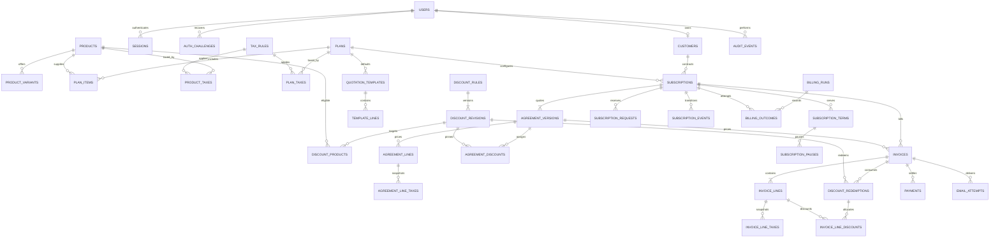

# Brightloop - Relational database design

Status: PROPOSED, dependent on acceptance of [business-rules.md](business-rules.md). No SQLAlchemy models or migrations are created in Phase 0. PostgreSQL is the source of truth. A separate test database already exists; it is never a substitute for development history.

## Types and conventions

UUID primary keys for domain entities; BIGINT identity for append-only events/run outcomes if useful. Unique human-readable numbers use database sequences, not MAX(number)+1; gaps are allowed. Dates are DATE for contractual calendar boundaries; audit/session instants are timezone-aware TIMESTAMPTZ. Monetary values NUMERIC(18,2), rates NUMERIC(7,4); never floats. Quantity is INTEGER > 0. Currency CHAR(3) is constrained to the configured currency in this version. JSONB is limited to safe audit context, action payloads and processing diagnostics, not a replacement for relational financial lines or ownership.

Every required field is NOT NULL. Nullable fields below are explicitly optional. Mutable roots carry `version` integer for optimistic conflict checks and updated timestamps. Creation actor FKs reference users; financial/history rows use RESTRICT deletion. Hash/token columns never contain raw passwords or bearer values. Document DTOs remain separate from ORM models.

## Entities, fields and constraints

Common `id`, created_at and FK indexes are omitted from field lists only for readability. Every referenced child has its parent FK; explicit indexes below follow actual screens/queries.

| Entity | Main fields and constraints | Purpose |
|---|---|---|
| users | email_normalized UNIQUE, name, password_hash, role CHECK ADMIN/STAFF/CUSTOMER, active, version | One role per login; no role-join table needed |
| customers | user_id NULL UNIQUE FK users, email_normalized UNIQUE, name, company NULL, phone NULL, billing address fields, version | Customer may predate portal account; one-to-zero/one user |
| sessions | user_id, token_hash UNIQUE, csrf_hash, expires_at, revoked_at NULL | Revocable hashed opaque sessions |
| auth_challenges | purpose CHECK RESET/LINK_SIGNUP/PREAUTH_CSRF, token_hash UNIQUE, email_normalized NULL, customer_id NULL, user_id NULL, pending_password_hash NULL, pending_name NULL, expires_at, consumed_at NULL | Reset/linking and pre-login CSRF context; purpose-specific nullability checks |
| command_receipts | actor_id, operation, request_key, request_hash, result_type/id, created_at; UNIQUE(actor_id,operation,request_key) | Replay lifecycle/create/review commands without duplicate effects; result identity only, not financial content |
| products | name, type, sales_price >= 0, cost_price >= 0, notes NULL, active, version | Admin catalog; archive referenced records |
| product_variants | product_id, name, price_adjustment, active; UNIQUE(product_id,name), UNIQUE(id,product_id) | Variant belongs to exactly one product; final price validated under lock |
| plans | name, description NULL, base_fee >= 0, minimum_seats > 0, extra_seat_unit_price >= 0, interval CHECK four units, available_from/to NULL, payment_term_days >= 0, flags, active, version | Flat included-seat fee and explicit excess pricing |
| plan_items | plan_id, ordinal, product_id, variant_id NULL, included_quantity > 0; UNIQUE(plan_id,ordinal) | Explicit zero-increment entitlements |
| tax_rules | name, classification, rate BETWEEN 0 AND 100, active, version | Current rules copied into agreement tax snapshots |
| product_taxes | product_id, tax_rule_id; composite PK | Normalized product tax applicability |
| plan_taxes | plan_id, tax_rule_id; composite PK | Base/excess-seat tax applicability |
| discount_rules | name, maximum_uses NULL CHECK > 0, disabled_from NULL, version | Stable identity/global cap across revisions; usage derived from redemptions |
| discount_revisions | rule_id, revision, type FIXED/PERCENT, amount/rate exclusive validated fields, minimum_purchase NULL >= 0, minimum_quantity NULL > 0, scope PRODUCT/SUBSCRIPTION, valid_from/to, UNIQUE(rule_id,revision) | Immutable terms pinned by assignments; validity ordered |
| discount_products | revision_id, product_id; composite PK | Product scope targets; service validates non-empty for PRODUCT only |
| quotation_templates | name, description NULL, plan_id, validity_days > 0, active, version | Catalog defaults only; never referenced as live historical prices |
| template_lines | template_id, ordinal, product_id, variant_id NULL, quantity > 0, line_kind INCLUDED/ADDON; UNIQUE(template_id,ordinal) | Reusable line selections; current price at draft creation |
| subscriptions | number UNIQUE, customer_id, plan_id, state, seat_quantity > 0, next_billing_date NULL, version, creator_id | Stable aggregate from Draft through terms/renewals; current fields are caches |
| subscription_terms | subscription_id, sequence, start_date, expiry_date, original_anchor_date, interval, plan-policy snapshot flags, source_version_id; UNIQUE(subscription_id,sequence), expiry > start | Explicit contiguous or lapsed service terms and billing anchors |
| agreement_versions | subscription_id, sequence, term_id NULL, template_id NULL, state DRAFT/ISSUED/ACCEPTED/SUPERSEDED, quote_number NULL UNIQUE, issued_date NULL, valid_until NULL, accepted_at NULL, effective_from NULL, seat_quantity > 0, proposed dates/interval/policy, payment_terms, currency; UNIQUE(subscription_id,sequence) | A quote becomes an agreed version; no second duplicate quote-line aggregate |
| agreement_lines | version_id, ordinal, kind PLAN_FEE/EXCESS_SEATS/INCLUDED/ADDON, product_id NULL, variant_id NULL, snapshot name/type/variant, quantity > 0, unit_price >= 0, override_reason NULL; UNIQUE(version_id,ordinal), UNIQUE(id,version_id) | Normalized historical prices, included lines zero price; synthetic plan lines allowed |
| agreement_line_taxes | line_id, source_tax_id, snapshot name/classification/rate | Immutable tax values; UNIQUE(line_id,source_tax_id) |
| agreement_discounts | version_id, revision_id; UNIQUE(version_id,revision_id) | Pin assigned discount terms, validate non-overlap in service |
| subscription_requests | subscription_id, requested_by, type, requested_date, desired_items JSONB NULL, displayed_price_summary JSONB NULL, based_on_version, status, reviewer_id NULL, reason/note, reviewed_at NULL | Intent/preview only; approved amounts stored in relational agreement lines |
| subscription_events | subscription_id, term_id NULL, request_id NULL UNIQUE, action, effective_date, agreement_id NULL, actor_id NULL, applied_at NULL, safe payload | Apply boundary action once; system actor explicitly nullable |
| subscription_pauses | term_id, start_date, resumed_date NULL, original_expiry_date, pause_event_id UNIQUE, resume_event_id NULL UNIQUE | Replayable exclusion intervals and expiry extension; end > start when present |
| invoices | number UNIQUE, subscription_id, term_id, agreement_id, customer_id, period_start/end, invoice_date, due_date, currency, state, subtotal/discount/tax/total snapshots, issued_at NULL, cancelled_at/reason NULL, issuer/customer/address snapshots | UNIQUE(subscription_id,period_start); end > start; total = subtotal - discount + tax >= 0 |
| invoice_lines | invoice_id, ordinal, agreement_line_id, snapshot description/product/variant, quantity > 0, unit_price >= 0, subtotal/discount/tax/total >= 0; UNIQUE(invoice_id,ordinal), UNIQUE(id,invoice_id) | Frozen line values; discount <= subtotal; total identity checked |
| invoice_line_taxes | invoice_line_id, snapshot tax name/rate/base/amount, source_tax_id | Itemized historic taxes rather than JSON arithmetic |
| invoice_line_discounts | invoice_line_id, redemption_id, invoice_id, allocated_amount >= 0 | Exact per-line allocations; composite FKs keep line/redemption on same invoice |
| discount_redemptions | rule_id, revision_id, invoice_id, amount >= 0; UNIQUE(rule_id,invoice_id), UNIQUE(id,invoice_id) | Authoritative usage; rule/revision consistency via composite FK |
| payments | invoice_id, amount > 0, method enum, payment_date, note non-empty, reference NULL, recorded_by, request_key UNIQUE, request_hash | Immutable ledger; key/payload mismatch conflicts; no client actor |
| billing_runs | requested_by NULL, trigger MANUAL/CLI/SCHEDULED, as_of_date, started/finished_at, state, summary counts | Operational trace, not financial truth |
| billing_outcomes | run_id, subscription_id, period_start, invoice_id NULL, state CREATED/EXISTING/FAILED, safe error code NULL | Every attempted period accounted for, repeated runs retain attempts |
| email_attempts | invoice_id NULL, auth_challenge_id NULL, kind, status PENDING/SENT/FAILED, attempt count/time, safe error code NULL | SMTP delivery visibility without secrets/body/reset URLs |
| audit_events | actor_id NULL, action, target_type/id, timestamp, safe context | Append-only explanation of significant changes |

No company-settings table is needed for the initial single issuer: validated environment/config values are copied into invoice snapshots. No separate plan-price service, payment-allocation ledger or role-assignment table is justified by current scope.

## ER diagram

This relationship overview groups supporting junction/snapshot tables; the entity table above is the full schema inventory. `customers.user_id` is nullable; every CUSTOMER user must have one linked customer, enforced transactionally.

## Integrity beyond field types

- Composite `(variant_id, product_id)` references the variant's `(id, product_id)` on catalog and historical lines; a variant cannot be paired with another product. Null product/variant permitted only for synthetic plan/excess lines; INCLUDED/ADDON require a product.
- Composite ownership references prevent an invoice's customer, term or agreement belonging to a different subscription. Add UNIQUE(id,customer_id) on subscriptions and UNIQUE(id,subscription_id) on terms/versions as FK targets; invoice pairs reference those. Redemption `(revision_id,rule_id)` references matching revision; line-discount `(redemption_id,invoice_id)` and `(line_id,invoice_id)` reference the same invoice.
- Subscription seats, minimum seats and snapshots are validated under subscription/catalog locks; cross-row minimums cannot be a simple CHECK. Included lines have zero unit price; PLAN_FEE quantity is 1. A service validates complete line-kind combinations.
- Only one draft version and one open pause per subscription/term: partial unique indexes. Accepted version effective dates are unique per subscription; same-date replacements are rejected. Term overlap and agreement boundary alignment are checked under the subscription row lock on every write, including renewals. They are not falsely claimed to be ordinary CHECK constraints.
- Invoice period end is deterministic from locked historical terms/events and persisted once. The unique start is stronger than a start/end key that could allow two different end dates for the same start. Changed dates must not overlap issued periods; validate under the same lock. No alternate reissue number bypasses this rule.
- Invoice header sums must match line/tax/discount children; verify in the service transaction and integration tests. Cross-row sums, global discount caps and invoice overpayment are service/locking invariants, not simple column checks. Make financial writes available only through that service to the application.
- Sessions/reset/link tokens are hashed and expiry-bound. Customer-user link requires a CUSTOMER role, normalized email match and verified ownership. Enforce these cross-table checks in the identity transaction; database uniqueness prevents racing links.
- Accepted/issued commercial rows are immutable through service APIs. Only audit-backed lifecycle/issue/cancellation fields may change. SQL migrations are not permission to rewrite financial history.

## Deletion and query indexes

Archive products/variants/plans/taxes/templates; version discounts. Financial/history FKs use RESTRICT/NO ACTION, including original catalog references. Allow CASCADE only for disposable sessions/challenges or unissued draft children when a service explicitly discards a draft. Users/customers with history are deactivated/retained rather than deleted. Audit actor deletion is restricted. No public financial DELETE endpoint.

Indexes to review with EXPLAIN and actual queries:

| Query | Candidate index |
|---|---|
| Login/link | unique normalized email; unique token hashes; session(user_id,expires_at) |
| Customer portal lists | subscriptions(customer_id,created_at,id); invoices(customer_id,invoice_date,id) |
| Operational queues | subscriptions(state,next_billing_date,id); terms(expiry_date,subscription_id) |
| Period lookup | unique invoices(subscription_id,period_start) |
| Unpaid/overdue | invoices(due_date,id) filtered issued/non-cancelled where useful |
| Balance and receipts | payments(invoice_id); payments(payment_date,id) |
| Rule cap/replay | unique redemptions(rule_id,invoice_id); events(subscription_id,effective_date,id) |
| Pending requests | requests(status,subscription_id,created_at); versions(subscription_id,effective_from) |
| Run diagnostics | outcomes(run_id,state,id); email_attempts(invoice_id,created_at) |

Use prefix/exact number/email search initially, not arbitrary full-table substring scans; page forms label supported search. Add trigram/full-text infrastructure only if measured requirements justify it. Invoice-paid totals may be cached only transactionally; payments remain authoritative. Test composite FKs, concurrency, rollback, archive protection and ownership on actual PostgreSQL in their introducing phase.
